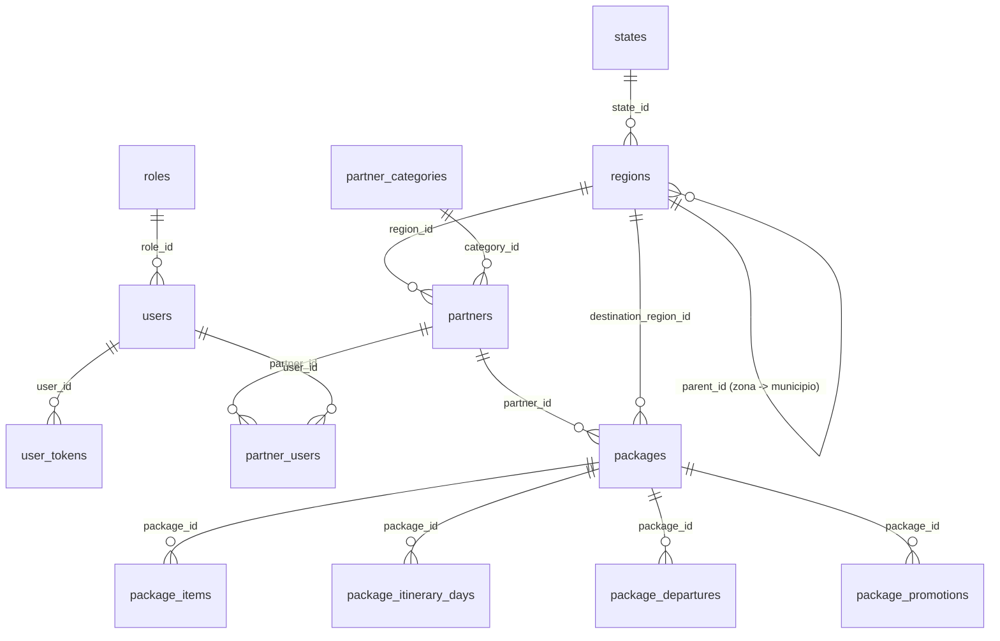

# Entidades del sistema

Documentación del modelo de datos de la plataforma turística. Cubre el dominio **Platform Manager** (catálogos, socios, usuarios) y la rama de **agencias de viajes** (paquetes).

> **Contexto de negocio.** El viajero **nunca** tiene cuenta ni inicia sesión: interactúa solo por WhatsApp y se identifica por su `whatsapp_id`. La plataforma web existe para que el `super_user` registre socios y para que hoteles y agencias carguen su oferta, que es la base de conocimiento que consulta la IA.

---

## Índice

1. [Convenciones](#convenciones)
2. [Diagrama de relaciones](#diagrama-de-relaciones)
3. [Catálogos geográficos](#catálogos-geográficos): `State`, `Region`
4. [Socios](#socios): `PartnerCategory`, `Partner`
5. [Acceso y usuarios](#acceso-y-usuarios): `Role`, `User`, `UserToken`, `PartnerUser`
6. [Paquetes turísticos](#paquetes-turísticos): `Package`, `PackageItem`, `PackageItineraryDay`, `PackageDeparture`, `PackagePromotion`
7. [Seeders](#seeders)
8. [Flujos principales](#flujos-principales)
9. [Reglas que viven en el servicio](#reglas-que-viven-en-el-servicio)
10. [Pendiente](#pendiente)

---

## Convenciones

| Tema | Regla |
|---|---|
| Base de datos | MySQL |
| Llaves primarias | UUID (`varchar(36)`). Las FK deben usar el mismo tipo y longitud |
| Nombres de archivo | `PascalCase` (ej. `PartnerUser.ts`) |
| Columnas en BD | `snake_case` (`@Column({ name: "partner_id" })`) |
| Propiedades en TS | `camelCase` |
| Fechas con hora | `timestamp` |
| Fechas sin hora | `date` (TypeORM las entrega como `"YYYY-MM-DD"`, tipadas como `string`) |
| Arrays | `json` (MySQL no tiene arrays). Un `json` no admite default literal: enviar siempre `[]` como mínimo |
| Decimales | `decimal` con *transformer* a `number` (MySQL los devuelve como string) |
| Relaciones | Por string + `Relation<>` (`@ManyToOne("Partner", ...)`) para evitar referencias circulares en ES Modules |
| Bajas | Nunca borrado físico: se cambia el `status` / `is_active` |
| Borrado en FK | `RESTRICT` por defecto; `CASCADE` solo en tablas hijas de detalle |
| Migraciones | `synchronize: false`; todo cambio pasa por `npm run migration:generate` |

Todas las entidades deben estar registradas en `AppDataSource`, o la migración no las detecta.

---

## Diagrama de relaciones

---

## Catálogos geográficos

### `State` (tabla `states`)

Catálogo cerrado de las 32 entidades federativas. Se carga con seeder; no se crea desde la interfaz.

| Columna | Tipo | Nulo | Descripción |
|---|---|---|---|
| `id` | varchar(36) | No | PK |
| `code` | varchar(2) | No | Clave INEGI (ej. `23` = Quintana Roo). **Único** |
| `name` | varchar(100) | No | Nombre oficial |
| `slug` | varchar(120) | No | **Único** (ej. `quintana-roo`) |
| `aliases` | json | No | Nombres alternativos (ej. `["Q. Roo"]`) |
| `is_active` | boolean | No | Default `false`. Solo se activan los estados con oferta |
| `created_at`, `updated_at` | timestamp | No | Auditoría |

**Relaciones:** ninguna declarada en esta entidad. La FK vive en `regions.state_id`.

### `Region` (tabla `regions`)

Municipios y zonas turísticas. Es la llave para que el agente filtre por destino.

| Columna | Tipo | Nulo | Descripción |
|---|---|---|---|
| `id` | varchar(36) | No | PK |
| `state_id` | varchar(36) | No | FK a `states`. Siempre obligatoria |
| `parent_id` | varchar(36) | Sí | FK a `regions`. `NULL` en municipios; el municipio padre en zonas |
| `type` | enum | No | `municipality` \| `zone` |
| `name` | varchar(150) | No | Nombre visible |
| `slug` | varchar(180) | No | **Único** |
| `aliases` | json | No | Para resolver texto libre ("Cancun", "Cun") |
| `lat`, `lng` | decimal(10,7) | Sí | Centro aproximado |
| `status` | enum | No | `active` \| `inactive` (default `active`) |
| `created_at`, `updated_at` | timestamp | No | Auditoría |

**Ejemplo:** `Benito Juárez` (municipality, `parent_id = NULL`) → `Zona Hotelera Cancún` (zone, `parent_id` = id de Benito Juárez). Ambas con `state_id` = Quintana Roo.

**Índices:** único `slug`; `(state_id, type, status)`; `state_id`; `parent_id`.

**Nota:** `parent_id` solo se necesita si se manejan zonas. Si el MVP trabaja solo con municipios, puede quedar siempre en `NULL`.

---

## Socios

### `PartnerCategory` (tabla `partner_categories`)

Catálogo fijo con el tipo de socio. Se carga con seeder.

| Columna | Tipo | Nulo | Descripción |
|---|---|---|---|
| `id` | varchar(36) | No | PK |
| `code` | varchar(30) | No | **Único**: `hotel`, `agency`, `attraction` |
| `name` | varchar(100) | No | Nombre visible |
| `is_active` | boolean | No | Default `true` |
| `created_at`, `updated_at` | timestamp | No | Auditoría |

El código de la aplicación usa los `code` (conviene un enum `PartnerCategoryCode`) para decidir qué puede hacer cada socio.

### `Partner` (tabla `partners`)

La **empresa**: un hotel, una agencia de viajes o un operador de atractivos. Una sola tabla para los tres; los distingue `category_id`.

| Columna | Tipo | Nulo | Descripción |
|---|---|---|---|
| `id` | varchar(36) | No | PK |
| `category_id` | varchar(36) | No | FK a `partner_categories` |
| `region_id` | varchar(36) | No | FK a `regions` |
| `commercial_name` | varchar(150) | No | Nombre comercial |
| `legal_name` | varchar(200) | No | Razón social |
| `slug` | varchar(180) | No | **Único** |
| `description` | text | Sí | Descripción corta |
| `address` | varchar(255) | No | Dirección |
| `lat`, `lng` | decimal(10,7) | Sí | Ubicación exacta (GPS en recordatorios) |
| `contact_name` | varchar(150) | No | Contacto principal |
| `contact_email` | varchar(150) | No | Correo |
| `contact_phone` | varchar(30) | No | Teléfono |
| `status` | enum | No | `pending` \| `active` \| `suspended` \| `rejected` (default `pending`) |
| `status_reason` | varchar(255) | Sí | Motivo de rechazo o suspensión |
| `approved_at` | timestamp | Sí | Cuándo se validó |
| `created_at`, `updated_at` | timestamp | No | Auditoría |

**Índices:** único `slug`; `(region_id, status)` (filtro principal del agente); `(category_id, status)`.

**Estados:** `pending → active ⇄ suspended`, y `pending → rejected`. Solo `active` es visible para el agente.

---

## Acceso y usuarios

### `Role` (tabla `roles`)

Rol global de una cuenta. Solo dos, cargados por seeder.

| Columna | Tipo | Nulo | Descripción |
|---|---|---|---|
| `id` | varchar(36) | No | PK |
| `code` | varchar(30) | No | **Único**: `super_user`, `partner` (enum `RoleCode`) |
| `name` | varchar(100) | No | Nombre visible |
| `is_active` | boolean | No | Default `true` |
| `created_at`, `updated_at` | timestamp | No | Auditoría |

| Rol | Quién es |
|---|---|
| `super_user` | Equipo de la plataforma: regiones, alta y validación de socios, supervisión |
| `partner` | Personal de hoteles, agencias y operadores que carga su oferta |

No existe rol `tourist`: el viajero no tiene cuenta.

### `User` (tabla `users`)

Persona que inicia sesión en el panel web.

| Columna | Tipo | Nulo | Descripción |
|---|---|---|---|
| `id` | varchar(36) | No | PK |
| `role_id` | varchar(36) | No | FK a `roles` |
| `name` | varchar(150) | No | Nombre |
| `email` | varchar(150) | No | **Único**. Es el login |
| `phone` | varchar(30) | Sí | Teléfono |
| `password_hash` | varchar(255) | **Sí** | `NULL` mientras el usuario está `invited`. `select: false` |
| `status` | enum | No | `invited` \| `active` \| `inactive` (default `invited`) |
| `must_change_password` | boolean | No | Default `false`. Lo usa el `super_user` sembrado |
| `last_login_at` | timestamp | Sí | Último ingreso |
| `created_at`, `updated_at` | timestamp | No | Auditoría |

- `password_hash` no se devuelve en consultas normales. En el login hay que pedirlo con `addSelect("user.passwordHash")` y validar que no sea `null`.
- El login **solo** acepta usuarios `active`.

### `UserToken` (tabla `user_tokens`)

Enlaces de un solo uso enviados por correo (activación de cuenta y, a futuro, "olvidé mi contraseña").

| Columna | Tipo | Nulo | Descripción |
|---|---|---|---|
| `id` | varchar(36) | No | PK |
| `user_id` | varchar(36) | No | FK a `users` (`CASCADE`) |
| `type` | enum | No | `activation` \| `password_reset` |
| `token_hash` | varchar(64) | No | **Único**. Hash SHA-256 del token |
| `expires_at` | timestamp | No | Vencimiento (ej. 48 h) |
| `used_at` | timestamp | Sí | Se llena al usarse (un solo uso) |
| `created_at` | timestamp | No | Creación |

**Regla de seguridad:** a la base solo va el **hash**. El token en claro viaja únicamente en el correo.

### `PartnerUser` (tabla `partner_users`)

Vínculo entre una persona y una empresa: "María es `owner` del Hotel Playa Azul".

| Columna | Tipo | Nulo | Descripción |
|---|---|---|---|
| `id` | varchar(36) | No | PK |
| `partner_id` | varchar(36) | No | FK a `partners` |
| `user_id` | varchar(36) | No | FK a `users` |
| `role` | enum | No | `owner` \| `staff` (default `staff`) |
| `is_active` | boolean | No | Default `true` |
| `created_at`, `updated_at` | timestamp | No | Auditoría |

**Índice único:** `(partner_id, user_id)`.

### Los dos "roles" no son lo mismo

| Campo | Qué define |
|---|---|
| `users.role_id` → `roles` | Tipo de cuenta: `super_user` o `partner` |
| `partner_users.role` | Puesto dentro de **un** socio: `owner` o `staff` |

Cuando una persona del panel inicia sesión, el sistema busca en `partner_users` a qué socio pertenece y solo le muestra los datos de ese socio.

---

## Paquetes turísticos

Rama de las agencias. Todas las tablas cuelgan de `packages`.

### `Package` (tabla `packages`)

| Columna | Tipo | Nulo | Descripción |
|---|---|---|---|
| `id` | varchar(36) | No | PK |
| `partner_id` | varchar(36) | No | FK a `partners` (la agencia) |
| `destination_region_id` | varchar(36) | No | FK a `regions` |
| `name` | varchar(150) | No | Ej. "Escapada Caribeña" |
| `slug` | varchar(180) | No | **Único** |
| `summary` | varchar(300) | No | Descripción corta |
| `description` | text | No | Descripción completa |
| `nights` | int | No | Noches (días = noches + 1) |
| `min_travelers` | int | No | Default `1` |
| `max_travelers` | int | Sí | Máximo por reserva |
| `child_min_age`, `child_max_age` | int | Sí | Rango que paga tarifa de menor |
| `meeting_point` | varchar(255) | Sí | Punto de salida o encuentro |
| `requirements` | text | Sí | Documentos, edad mínima, restricciones |
| `cancellation_policy` | text | No | Reglas de cancelación (texto en el MVP) |
| `taxes_included` | boolean | No | Default `true` |
| `status` | enum | No | `draft` \| `published` \| `paused` (default `draft`) |
| `created_at`, `updated_at` | timestamp | No | Auditoría |

**Índices:** único `slug`; `(partner_id, status)`; `(destination_region_id, status)`.

### `PackageItem` (tabla `package_items`)

Qué incluye y qué no incluye el paquete.

| Columna | Tipo | Nulo | Descripción |
|---|---|---|---|
| `id` | varchar(36) | No | PK |
| `package_id` | varchar(36) | No | FK a `packages` (`CASCADE`) |
| `type` | enum | No | `lodging` \| `transport` \| `meals` \| `activity` \| `other` |
| `description` | varchar(255) | No | Ej. "Hotel 3 estrellas, 3 noches" |
| `is_included` | boolean | No | `true` incluye, `false` no incluye |
| `sort_order` | int | No | Orden de aparición |

### `PackageItineraryDay` (tabla `package_itinerary_days`)

| Columna | Tipo | Nulo | Descripción |
|---|---|---|---|
| `id` | varchar(36) | No | PK |
| `package_id` | varchar(36) | No | FK a `packages` (`CASCADE`) |
| `day_number` | int | No | 1, 2, 3... |
| `title` | varchar(150) | No | Ej. "Llegada y traslado" |
| `description` | text | No | Qué se hace ese día |

**Índice único:** `(package_id, day_number)`.

### `PackageDeparture` (tabla `package_departures`)

Fechas de salida, cupos y precio. El precio vive aquí porque la temporada alta y baja suelen costar distinto.

| Columna | Tipo | Nulo | Descripción |
|---|---|---|---|
| `id` | varchar(36) | No | PK |
| `package_id` | varchar(36) | No | FK a `packages` (`CASCADE`) |
| `departure_date` | date | No | Fecha de salida |
| `total_seats` | int | No | Cupo total |
| `sold_seats` | int | No | Default `0` (se usa cuando existan reservas) |
| `adult_price` | decimal(10,2) | No | Precio por adulto |
| `child_price` | decimal(10,2) | Sí | Precio por menor |
| `status` | enum | No | `open` \| `closed` (`closed` = cierre rápido) |
| `created_at`, `updated_at` | timestamp | No | Auditoría |

**Índices:** único `(package_id, departure_date)`; `(departure_date, status)`.

`held_seats` (bloqueo temporal de 15 minutos) no existe todavía: se agrega al construir las reservas.

### `PackagePromotion` (tabla `package_promotions`)

| Columna | Tipo | Nulo | Descripción |
|---|---|---|---|
| `id` | varchar(36) | No | PK |
| `package_id` | varchar(36) | No | FK a `packages` (`CASCADE`) |
| `name` | varchar(120) | No | Ej. "Promo entre semana" |
| `discount_type` | enum | No | `percentage` \| `fixed` |
| `discount_value` | decimal(10,2) | No | `10` (%) o `500` (MXN) |
| `valid_from`, `valid_to` | date | No | Vigencia |
| `min_travelers` | int | Sí | Condición: mínimo de personas |
| `days_of_week` | json | Sí | Condición: días de salida válidos (0 = domingo … 6 = sábado), ej. `[1,2,3,4]` |
| `status` | enum | No | `active` \| `inactive` (default `active`) |
| `created_at`, `updated_at` | timestamp | No | Auditoría |

**Índice:** `(package_id, status)`.

**Cálculo del precio final** (siempre desde la API, nunca inventado por la IA): precio de la salida, menos la promoción vigente que aplique, más impuestos si `taxes_included = false`.

---

## Seeders

Se ejecutan de menor a mayor `order`, son idempotentes y viven en `src/core/bd/seeds/seeders/`.

| order | Seeder | Qué carga | Estrategia |
|---|---|---|---|
| 1 | `states` | 32 estados (`is_active = false`; se activan los del MVP) | `upsert` por `code` |
| 2 | `municipalities` | Municipios de los destinos del MVP | `upsert` por `slug` |
| 3 | `partner-categories` | `hotel`, `agency`, `attraction` | `upsert` por `code` |
| 4 | `roles` | `super_user`, `partner` | `upsert` por `code` |
| 5 | `users` | Primer `super_user` (credenciales desde `.env`) | Busca por email; **no** usa `upsert` |

**Por qué `users` no usa `upsert`:** actualizaría el `password_hash` en cada ejecución y pisaría una contraseña que ya se cambió.

**Por qué los seeders de catálogo no envían `is_active`:** al omitirlo, la primera vez se inserta con el default, pero volver a correr el seeder no reactiva un registro que se desactivó a propósito.

Variables de entorno requeridas por el seeder de `users`: `SUPER_USER_NAME`, `SUPER_USER_EMAIL`, `SUPER_USER_PASSWORD`.

---

## Flujos principales

### Alta de un socio

Lo ejecuta un `super_user` con un solo formulario en dos secciones (empresa y encargado). `POST /partners`, en **una transacción**:

1. Crea el `partner` con `status = pending`.
2. Crea el `user` del encargado con rol `partner`, `status = invited` y `password_hash = NULL`.
3. Crea la fila de `partner_users` con `role = owner`.

Después, **fuera de la transacción**: genera el token de activación (se guarda su hash en `user_tokens`) y envía el correo por Gmail (SMTP, contraseña de aplicación). Si el correo falla, el socio y el usuario ya existen y se resuelve con el reenvío de invitación.

### Activación de cuenta

1. El encargado abre el enlace del correo (`APP_URL` + token).
2. `POST /auth/activate` valida que el token exista, no haya vencido y no se haya usado.
3. Se guarda el `password_hash`, el usuario pasa a `active` y el token se marca con `used_at`.

### Publicación de un paquete

1. La agencia crea el paquete (`draft`) con sus ítems, itinerario, salidas y, opcionalmente, promociones.
2. Puede cargar todo aunque su cuenta siga `pending`.
3. Al pasar a `published`, se valida lo mínimo (ver reglas).
4. El agente solo lo ofrece si el socio está `active`, la región está activa y hay una salida `open` con cupo.

---

## Reglas que viven en el servicio

Estas reglas no se pueden expresar con constraints de la base de datos y deben validarse en el código.

**Regiones**
- Si `type = municipality`, `parent_id` debe ser `NULL`.
- Si `type = zone`, `parent_id` debe apuntar a un municipio.
- El `state_id` de una zona debe coincidir con el de su municipio padre.

**Socios y usuarios**
- `status_reason` es obligatorio al rechazar o suspender un socio.
- `approved_at` se llena al pasar a `active`.
- El `slug` se genera a partir del nombre y debe resolver colisiones.
- Solo usuarios con rol `partner` se vinculan en `partner_users`.
- Cada socio debe tener siempre al menos un `owner` activo.
- El correo del encargado debe ser único; si ya existe, el alta falla con un mensaje claro.
- Cada endpoint del panel filtra por el `partner_id` del usuario autenticado.
- Un socio `hotel` solo usa las rutas de habitaciones; uno `agency`, las de paquetes.

**Paquetes**
- Para publicar: al menos un ítem incluido, un día de itinerario y una salida con precio.
- `child_min_age` < `child_max_age`; `valid_from` ≤ `valid_to`.
- `sold_seats` nunca supera `total_seats`.
- Si hay varias promociones vigentes, se aplica solo la de mayor descuento.

---

## Pendiente

| Pieza | Nota |
|---|---|
| Migración inicial | Registrar todas las entidades en `AppDataSource` y correr `migration:generate` |
| `approved_by` en `Partner` | FK a `users`; migración nueva ahora que `users` existe |
| Servicio de correo | Gmail vía `nodemailer` (SMTP 465); agregar bloque `mail` a `METACONFIG` |
| Login y guards por rol | `POST /auth/login`, `POST /auth/activate` |
| Endpoints de socios | Alta, aprobar, rechazar, suspender, reenviar invitación |
| Endpoints de paquetes | CRUD del paquete y sus hijos, publicar |
| Rama de hoteles | `room_types`, `room_rates`, `room_inventory` |
| Rama de atractivos | `experiences`, horarios y aforos |
| Complementos de socio | `service_tags` (+ pivote), `partner_documents`, `partner_bank_accounts`, `audit_logs` |
| Reservas y viajeros | `travelers` (con `whatsapp_id`), `bookings`, `inventory_holds`, `payments`; aquí se agrega `held_seats` |
| Conversaciones | `conversations`, `messages`, `scheduled_notifications` para el agente |